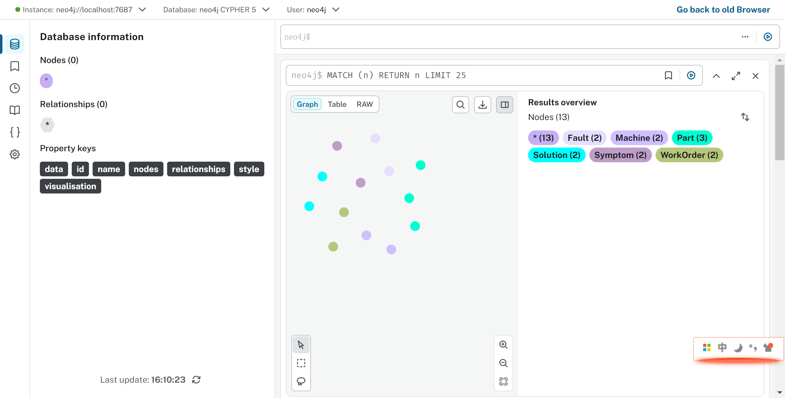
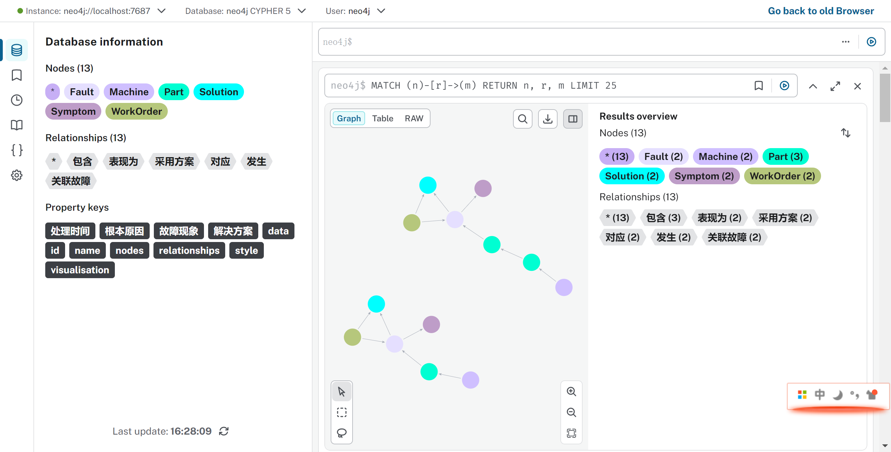
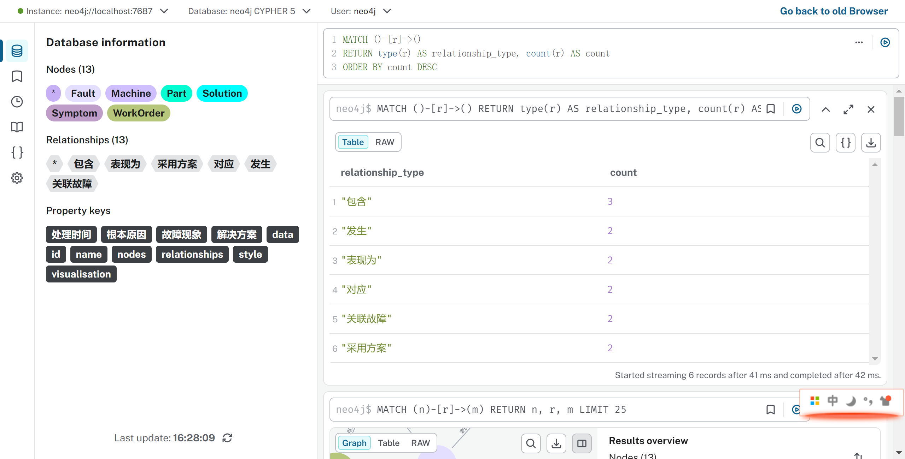

# 大模型应用作品集：RAG 与多智能体 Agent

> 运行 PPIO 接口示例前，请在运行进程中设置 PPIO_API_KEY。Neo4j 连接示例使用 NEO4J_PASSWORD。

基于 RAG（检索增强生成）与 LangGraph 多智能体工作流的端到端大模型应用示例，涵盖知识库构建、Agent 编排、模型微调与 API 部署。 
**场景示例**：机床故障诊断（可替换为文档问答、客服、知识库助手等）。

---

## 技术栈

| 模块 | 技术选型 |
|------|----------|
| **RAG** | B：Chroma + BGE；C：Qdrant 内存 + text2vec，可加载 B 导出 JSON |
| **Agent** | LangGraph（状态图、条件路由）、LangChain（Prompt/Chain）、OpenAI 兼容 API 或 D 微调模型 |
| **微调** | Llama Factory（SFT/LoRA）、Qwen2.5 |
| **部署** | FastAPI、Docker |

---

## 项目结构

```
program/
├── run.py              # 一键运行入口（见下方「一键运行」）
├── B_Data Preparation and Knowledge Base Construction/   # RAG：文档解析 → 分块 → 向量化 → 存储与检索
│   └── Building a Vector Knowledge Base (Core of RAG)/
│       └── projectB/   # 文档解析与分块、向量化与存储、检索器测试
├── C_Agent System Design and Development/                # Agent：多节点工作流、路由、检索/工具、合成
│   └── project/         # LangGraph 工作流 + 本地 Embedding + 低成本 LLM
├── D_Model Fine-tuning and Performance Improvement/      # 微调：数据准备、Llama Factory SFT/LoRA
├── E_System Integration, Evaluation and Deployment/      # 部署：FastAPI、Docker（含 app_server.py）
└── README.md
```

---

## 核心能力概览

### 1. 通用 RAG 流程

- **文档加载**：PDF/目录加载（可扩展为 Word、Markdown 等）。
- **文本分块**：按段落/标点切分，支持 `chunk_size` / `overlap` 配置。
- **向量化与存储**：本地 Embedding 模型（BGE、text2vec）+ Chroma 持久化。
- **检索**：相似度检索、可调 `k`，便于接入任意问答/Agent。

### 2. 通用多智能体工作流（LangGraph）

- **状态**：统一 State（如 question、retrieved_docs、similar_cases、final_answer）。
- **协调器节点**：根据用户意图做**条件路由**（如：走检索 vs 走案例/工具）。
- **子节点**：检索 Agent（调用 RAG）、案例/工具 Agent（业务逻辑或外部 API）。
- **合成节点**：将检索结果与工具结果拼成上下文，调用大模型生成最终回答。
- **可扩展**：新增节点或分支即可支持更多工具/数据源。

### 3. 微调与部署

- **微调**：基于 Llama Factory 的 SFT/LoRA 配置与指令数据格式，可复用到其他领域。
- **部署**：FastAPI 封装 Agent 调用，Docker 化便于本地/云部署。

---

## Neo4j 机床故障知识图谱

B 阶段使用 Neo4j 将设备、部件、故障、症状、解决方案和维修工单串联起来。以下三张 Neo4j Browser 截图展示了同一批样例数据的节点查询、关系可视化和关系统计。

### 查看节点

```cypher
MATCH (n)
RETURN n
LIMIT 25
```

查询返回 **13 个节点**，包括 `Machine`（设备）、`Part`（部件）、`Fault`（故障）、`Symptom`（症状）、`Solution`（解决方案）和 `WorkOrder`（工单）六种标签。结果面板中的 `*` 汇总全部节点。当前查询只返回节点，因此图中没有连线。若左侧统计仍为 0，可点击 **Database information** 面板底部的刷新图标。该面板还会列出 `name`、`id` 等属性键。



### 查看节点与关系

```cypher
MATCH (n)-[r]->(m)
RETURN n, r, m
LIMIT 25
```

图视图显示 **13 个节点和 13 条关系**。两组子图都能沿设备和部件找到故障，再查看症状、解决方案与维修工单。可在 Neo4j Browser 中调整节点大小、颜色和关系线条样式，便于区分不同类型。



### 统计关系类型

```cypher
MATCH ()-[r]->()
RETURN type(r) AS relationship_type, count(r) AS count
ORDER BY count DESC
```



| 关系 | 数量 | 样例含义 |
| --- | ---: | --- |
| 包含 | 3 | 设备包含部件，部件也可以包含下级部件 |
| 发生 | 2 | 部件发生故障 |
| 表现为 | 2 | 故障表现为症状 |
| 对应 | 2 | 故障对应解决方案 |
| 关联故障 | 2 | 工单关联故障 |
| 采用方案 | 2 | 工单采用解决方案 |

### 进一步查询

查看设备及其相邻节点。

```cypher
MATCH (n:Machine)-[r]-(m)
RETURN n, r, m
```

沿故障节点的出边查看一到三跳的路径。

```cypher
MATCH path = (f:Fault)-[*1..3]->()
RETURN path
```

查看设备和部件的包含关系。

```cypher
MATCH (a)-[:包含]->(b)
RETURN a.name AS parent_name, b.name AS child_name
```

查看工单关联的故障。

```cypher
MATCH (w:WorkOrder)-[:关联故障]->(f:Fault)
RETURN w.name AS work_order, f.name AS fault
```

按标签统计节点数量。

```cypher
MATCH (n)
UNWIND labels(n) AS node_label
RETURN node_label, count(*) AS count
ORDER BY count DESC
```

[查看原始运行记录](B_Data%20Preparation%20and%20Knowledge%20Base%20Construction/%E6%94%B6%E9%9B%86%E4%B8%8E%E6%95%B4%E7%90%86%E6%95%B0%E6%8D%AE/neo4j%E7%BB%93%E6%9E%9C.docx)

---

## 环境要求

- Python 3.10+
- 依赖见各模块内 `requirements*.txt`（LangChain、Chroma、LangGraph、FastAPI 等）
- 本地 Embedding 模型需提前下载至对应 `models/` 目录（或改用在线模型）

---

## 快速开始

### 一键运行（推荐）

在**项目根目录** `program/` 下执行：

```bash
# 运行多智能体故障诊断演示（单次调用并打印结果）
python run.py

# 启动诊断 API 服务（默认 http://0.0.0.0:8000），再通过 POST /diagnose 调用
python run.py --api
# 指定端口：python run.py --api --port 8080
```

**前置条件**：已安装 C / E 模块依赖（LangChain、LangGraph、Qdrant、FastAPI、uvicorn 等），并在 `C_Agent System Design and Development/project/` 下配置好 `PPIO.env`（API Key、Base URL、Model）。向量库默认使用内置 3 条文档；若已运行 B 导出，则 C 会自动加载 B 的知识库（见下方「B→C 知识库」）。

---

### 分模块运行

#### 1. 构建 RAG 向量库（B 模块）

```bash
cd "B_Data Preparation and Knowledge Base Construction/Building a Vector Knowledge Base (Core of RAG)/projectB"
# 将 PDF 放入指定 data 目录后执行
python "文档解析与分块_向量化与存储_检索器测试.py"
```

#### 2. B→C 知识库（可选：用 B 的 PDF 知识库喂给 C）

C 使用 **Qdrant 内存**检索，不直接连 B 的 Chroma。若要用 B 建好的知识库：

1. 在 B 的 projectB 中先运行主脚本生成 Chroma 向量库；
2. 在同一目录运行导出脚本生成 `exported_chunks.json`：
   ```bash
   cd "B_Data Preparation and Knowledge Base Construction/Building a Vector Knowledge Base (Core of RAG)/projectB"
   python export_chunks_for_c.py
   ```
3. 之后运行 `python run.py` 或 `python run.py --api` 时，C 会自动读取该 JSON 并灌入 Qdrant。未导出时 C 使用默认 3 条文档。

Chroma 路径与 B 主脚本不一致时，可设置环境变量 `B_CHROMA_DB_DIR` 指向实际 chroma_db 目录。

#### 3. D 微调模型（可选：用本地微调模型替代 PPIO）

设置环境变量即可让 C 使用 D 模块的微调模型做合成回答：

```bash
# 使用默认路径 D_.../Perform SFT_LoRA.../merged_model
set USE_FINETUNED_MODEL=1
python run.py

# 指定微调模型目录
set USE_FINETUNED_MODEL=1
set FINETUNED_MODEL_PATH=D:\path\to\merged_model
python run.py
```

不设置或路径不存在时自动使用 PPIO 接口。

#### 4. 运行多智能体故障诊断（C 模块）

```bash
cd "C_Agent System Design and Development/project"
# 配置 PPIO.env 中的 API Key / Base URL / Model（使用 PPIO 时）
python "Multi-agent Fault Diagnosis System.py"
```

#### 5. 调用诊断 API（E 模块）

```bash
# 方式一：从根目录一键启动（推荐）
python run.py --api

# 方式二：进入 E 目录后启动
cd "E_System Integration, Evaluation and Deployment"
uvicorn app_server:app --host 0.0.0.0 --port 8000
# POST /diagnose  {"question": "主轴振动原因？"}
```

---

## 本次改动总结（B/D 接入 C + 配置/评估/案例库）

- **B→C（方案2）**：B 仅作数据源。新增 `projectB/export_chunks_for_c.py`，从 Chroma 导出为 `exported_chunks.json`；C 启动时若存在则灌入 Qdrant，否则用默认 3 条文档。
- **D→C**：环境变量 `USE_FINETUNED_MODEL`、`FINETUNED_MODEL_PATH`；启用时 C 使用 D 的微调模型做合成。
- **B 路径**：B 主脚本改为基于脚本位置计算路径（带 `B_` 前缀），支持 `B_PDF_DIR`、`B_CHROMA_DB_DIR`、`B_MODEL_PATH` 覆盖。
- **E 的 app / fastapi_app**：改为动态加载 C 的 Agent，可直接 `streamlit run app.py` 或 `uvicorn fastapi_app:app`（需 `PROGRAM_ROOT` 或从 program 上一级运行）。
- **统一配置**：根目录 `config.py` + `.env.example`；`run.py` 启动时加载根目录 `.env`，C 优先读根目录 `.env` 再读 PPIO.env；`HOST`/`PORT` 可从环境变量读取。
- **评估脚本**：根目录 `python eval_agent.py [--mode default|b|d]`，使用 `eval_questions.json` 对比默认/B/D 的准确率与耗时；评估默认模式时自动设 `SKIP_B_EXPORT=1`。
- **案例库**：C 从 `project/case_base.json` 加载（格式：`[{"keywords":[], "text":"案例..."}]`），缺省用内置列表，便于与 RAG/微调数据格式打通。

## 后续计划

- [ ] 将 D 微调数据与 `case_base.json` 格式对齐，便于从案例生成微调样本
